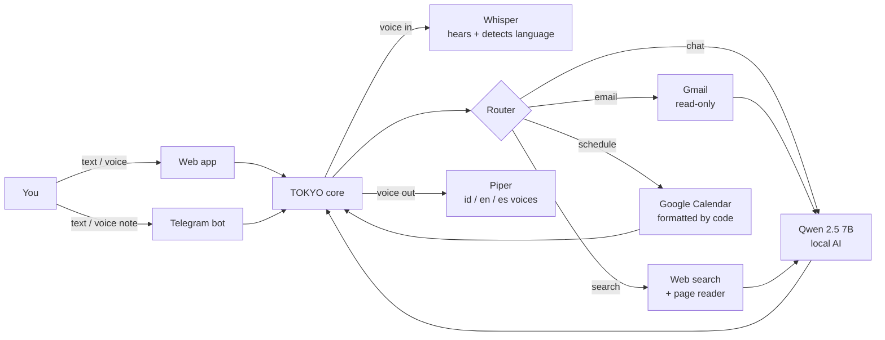

<div align="center">

# ⚡ TOKYO

### Your private AI assistant that knows your classes, reads your inbox and talks back in your language.

**T**racks **O**bligations, **K**eeps **Y**ou **O**n-time


[Meet TOKYO](#-meet-tokyo) · [See it in action](#-see-it-in-action) · [Get your own](#-get-your-own-tokyo-in-20-minutes) · [How it works](#-how-it-works) · [FAQ](#-faq)

</div>

---

## 👋 Meet TOKYO

TOKYO is a personal assistant that lives on **your own computer**, not in someone else's cloud. Think of it as a pocket chief of staff: it keeps track of where you need to be, what's waiting in your inbox and what the sky is about to do, and tells you in whichever language you happen to be thinking in.

| | |
|---|---|
| 🪪 **Name** | **T**racks **O**bligations, **K**eeps **Y**ou **O**n-time |
| 🚄 **Named after** | Tokyo's trains: punctual, precise, and you never have to think about how they work |
| 🗣️ **Speaks** | 🇮🇩 Bahasa Indonesia · 🇬🇧 English · 🇪🇸 Español, and switches the moment you do |
| 📱 **Where to find it** | Telegram (text or voice notes) and a web app |
| 🧠 **Knows** | Your Google Calendar, your Gmail inbox, today's weather, and the web |
| 😎 **Personality** | Casual, tactical, to the point: a friend who happens to have your timetable memorized |
| 🏠 **Lives** | On your laptop or your own server. Its AI brain, ears and voice all run locally |
| 🚫 **Won't** | Send or delete your emails, share your data, or make up your schedule |
| 🎂 **Born** | Madrid, 2026, for a Master's student juggling classes in three languages |

### A day with TOKYO

- **08:10** — Still in bed: 🎙️ *"Besok… eh, hari ini ada kelas apa?"* Classes, times and rooms, read out loud in Indonesian.
- **08:15** — *"What should I wear?"* Rain at 98%: waterproof jacket and an umbrella.
- **12:40** — Between lectures, a Spanish classmate asks about Wednesday. You ask TOKYO in Spanish; it answers in Spanish, midterm included.
- **18:30** — *"Cek emailku, ada yang penting?"* Two emails worth reading, one flagged as a possible phishing attempt.
- **21:00** — *"Tambahkan deadline Essay AI tanggal 30"* — and it's in your calendar.

---

## 💡 Why TOKYO exists

Studying abroad means juggling a timetable spread across rooms like MMB-602 and MMB-703, an inbox mixing university deadlines with promotions and security alerts, and a city where the weather decides between a coat and an umbrella. The information is all there, just scattered across apps and three languages.

The first TOKYO was a Streamlit dashboard on Gemini. It worked, but:

- **Privacy:** an assistant that reads your email shouldn't send it to a cloud AI.
- **Reliability:** the old code kept a list of five fallback models because servers were often busy. An assistant that sometimes isn't there isn't an assistant.
- **Learning:** building it locally means understanding every layer: speech, language detection, tool calling, OAuth, Docker. One API call teaches one thing; TOKYO teaches the whole stack.

---

## 🎬 See it in action

**🎙️ You:** *"Besok aku ada kelas apa?"*

```text
📅 Jadwalmu:
Senin 19/10 (BESOK):
  - 09:00-10:20 DATA MANAGEMENT I (Ses. 8) MMB-602
  - 10:30-11:50 INTRODUCTION TO AI AND MACHINE LEARNING (Ses. 8) MMB-602
  - 15:30-16:50 IS-RELATIONAL DATABASES-SQL LAB (Ses. 4) MMB-303
```

**🎙️ You:** *"¿Qué tengo el miércoles?"*

```text
📅 Tu horario:
miércoles 21/10:
  - 09:00-10:20 DATA MANAGEMENT I (Ses. 9) MMB-602
  - 10:30-11:50 INTRODUCTION TO AI AND MACHINE LEARNING (Ses. 9) MMB-602
  - 15:00-16:20 PROGRAMMING LAB (Ses. 2) MMB-703
```

**💬 You:** *"What should I wear today?"*

```text
🧥 Bring a jacket or a light sweater. It's a bit chilly with a high
   chance of rain, so a waterproof coat or umbrella would be wise.
```

**💬 You:** *"Cek emailku dong, ada yang penting?"*

```text
📬 Ada 2 email penting:
  1. Undangan dari kampus untuk career forum.
  2. Permintaan verifikasi akun.
     ⚠️ Cek langsung di aplikasi resminya, jangan klik link di email.
```

**💬 You:** *"Search the opening hours of Museo del Prado"*

```text
🔎 Monday to Saturday: 10:00-20:00
   Sundays and holidays: 10:00-19:00
   Source: the website TOKYO just read
```

Speak in Indonesian, English or Spanish, and TOKYO **answers in the same language, out loud**, on Telegram or in your browser.

---

## 💚 Why you'll like it

| | |
|---|---|
| 🔒 **Your data stays home** | The AI, speech recognition and voice run on *your* machine. Your emails are summarized locally, never sent to an AI company. |
| 🗣️ **Talk, don't type** | Send a voice note, get a voice reply. It hears which language you speak and switches automatically. |
| 📅 **Never wrong about your schedule** | Class times and rooms are read straight from Google Calendar by code, not "remembered" by an AI. Instant and exact. |
| 📬 **Inbox triage** | Important emails first, promotions filtered out, phishing-style emails flagged. Read-only: it can't send or delete anything. |
| 🌦️ **Dress for the day** | Live forecast turned into actual clothing advice. |
| 🔎 **Looks things up** | Opening hours, events, prices: it reads the web page and tells you its source. |
| 💶 **No subscription** | Open models, free APIs. The 1,000th question costs the same as the first: nothing. |

---

<div align="center">

### Convinced? Here's how to get your own. 👇

</div>

## 🚀 Get your own TOKYO in ~20 minutes

This guide is for anyone, including friends who want their own copy. You'll connect **your own** Google account. You never need the author's files, and the author can never see your data.

> 🔐 **Your TOKYO is completely separate.** Cloning gives you the *code* (the blueprint), not anyone's *keys*. Your calendar access is created when **you** log in with **your** Google account, and it lives only on your computer. Never share your `.env` or `secrets/` folder, and never ask anyone for theirs.

### What you need

- A computer with **16 GB RAM** or more (TOKYO uses about 7 GB)
- **[Docker Desktop](https://www.docker.com/products/docker-desktop/)** (or OrbStack on Mac), with **at least 8 GB memory** assigned in Settings → Resources
- About **10 GB** of free disk space
- A Google account
- Telegram (optional, to use TOKYO from your phone)
- Windows users: run the commands in **Git Bash** or **WSL**

### Step 1 — Get the code

```bash
git clone https://github.com/VinsensiusF/TOKYO.git tokyo-assistant
cd tokyo-assistant
cp .env.example .env
mkdir -p secrets
```

Open `.env` and set at least:

```
WEB_PASSWORD=choose-a-strong-password
DEFAULT_LANG=en          # id | en | es
```

### Step 2 — Create your own Google key (one time, ~10 min)

This lets TOKYO read **your** calendar and email.

1. Go to **[console.cloud.google.com](https://console.cloud.google.com)** and create a new project (any name, e.g. `my-tokyo`).
2. **APIs & Services → Library:** enable **Google Calendar API** and **Gmail API**.
3. **Google Auth Platform → Branding:** fill in an app name (`TOKYO`) and your email.
4. **Audience:** choose **External**, then click **Publish app**.
   *Why publish?* In "Testing" mode Google logs you out every 7 days and TOKYO silently stops seeing your calendar. Personal use needs no verification.
5. **Clients → Create client → Desktop app**, then **Download JSON**.
6. Save that file as **`secrets/credentials.json`** inside the project folder.

### Step 3 — Start TOKYO

```bash
docker compose up -d --build                         # first time: ~5-10 min
docker compose exec ollama ollama pull qwen2.5:7b    # the AI brain, ~4.7 GB
```

### Step 4 — Log in with your Google account

```bash
docker compose run --rm -p 8765:8765 web python google_login.py
```

1. Open the link printed in the terminal.
2. Sign in with **your** Google account.
3. You'll see *"Google hasn't verified this app"*. That's expected, because the app is yours: click **Advanced → Go to TOKYO**.
4. Tick **both** Calendar and Gmail, then **Continue**.
5. Wait for `✅ TOKEN SAVED`, then run:

```bash
docker compose restart web bot
```

### Step 5 — Say hi 👋

Open **[http://localhost:8501](http://localhost:8501)**, enter your password, and try:

- *"What do I have tomorrow?"*
- *"What should I wear today?"*
- 🎙️ Press the mic and ask anything in Indonesian, English or Spanish

The first answer takes about a minute while the model loads into memory. After that it's much faster.

### Step 6 (optional) — Put it on your phone with Telegram

1. In Telegram, message **@BotFather**, send `/newbot`, and copy the token into `.env` as `TELEGRAM_TOKEN=...`
2. Run `docker compose up -d bot`
3. Send "hi" to your new bot. It replies with your **chat ID** (it ignores strangers).
4. Put that number in `.env` as `ALLOWED_CHAT_IDS=...`, then run `docker compose up -d bot` again.

Now send it a voice note. 🎧

> 💡 After editing `.env`, always use `docker compose up -d <service>`. A plain `restart` doesn't reload `.env`.

### Make it yours (not in Madrid?)

TOKYO was built for a student in Madrid, so three things are set for Madrid. Change them for your city:

| What | Where |
|---|---|
| Timezone | `TZ_NAME=` in `.env` (e.g. `Asia/Jakarta`, `Europe/London`) |
| Weather location | latitude/longitude in the URL in `services/weather_svc.py` |
| Personality ("a Master's student in Madrid") | the first line of the prompt in `core/context.py` |

After editing code files, run `docker compose up -d --build web bot`.

### Turn it off or remove it

```bash
docker compose stop                 # pause TOKYO
docker compose down -v              # remove TOKYO and its downloaded models
```

To revoke TOKYO's access to your Google account at any time: **[myaccount.google.com/permissions](https://myaccount.google.com/permissions)**.

---

## 🧠 How it works



**One kitchen, two serving windows.** The web app and the Telegram bot are just windows; the cooking all happens in one shared core. Improve the kitchen once, and both windows get better.

**The life of a voice message:**
1. **Hear:** Whisper transcribes it and recognizes the language from your accent.
2. **Route:** keyword rules in 3 languages pick the path: email → web search → schedule → chat.
3. **Fetch:** Calendar, Gmail, weather or the web.
4. **Write:** code formats exact answers (schedules); the AI writes everything else, in your language.
5. **Speak:** Piper reads the reply in the matching voice.

### 🎯 The big lesson: code decides, the model writes

A small local AI is like a talented new intern: great at writing a friendly sentence, unreliable at precise bookkeeping. Every time we asked it to *choose* or *combine*, something broke:

| We asked the AI to… | What went wrong | Fix: let code decide |
|---|---|---|
| Summarize a week of classes | Mixed up times, shifted day labels by one | Code prints schedules directly |
| Understand *"minggu ini"* | Indonesian "minggu" means both *week* and *Sunday* | Code parses dates in 3 languages |
| Detect Spanish in *"¿Qué tengo el miércoles?"* | Too short for statistics | Count telltale words first (`qué`, `tengo`) |
| Notice the calendar was down | Said "no classes today" 😬 | Explicit "calendar not connected" message |
| Choose summer vs winter mass times | Blended both tables | Code drops the off-season table |
| Reconcile two websites that disagree | Stitched both together, cited the wrong one | Code keeps **one** best source |

> **If an answer must be exact, code produces it. If it must sound human, the model writes it.**

That's why schedule answers are instant (~0.1 s): the fastest, most accurate AI call is the one you don't make.

**Why Qwen 2.5 7B?** It's trained on 29+ languages including Indonesian and handles tool calling well. We started with the 3B version; it was fine for chat but misread a simple table of mass times. The 7B read it correctly. Switching is one line in `.env`.

---

## ❓ FAQ

Click a question to open it.

<details>
<summary><b>🔐 If my friend clones TOKYO, can they see or change my calendar?</b></summary>

<br>

**No.** The repository only contains code, never keys.

- Calendar access comes from a token created when **you** log in with **your** Google account.
- That token lives in your `secrets/` folder, which is never uploaded to Git.
- Your friend's TOKYO creates its own token, for **their** account only.

</details>

<details>
<summary><b>📬 Can TOKYO send, delete or change my emails?</b></summary>

<br>

**No.** Gmail access is **read-only**.

- ✅ It can read and summarize your inbox.
- ❌ It can't send, delete, archive or modify anything.
- ✍️ The only thing TOKYO ever writes is a new calendar event, and only when you ask.

</details>

<details>
<summary><b>☁️ Does anything go to the cloud?</b></summary>

<br>

**The AI itself never leaves your machine.**

| Runs on your machine | Talks to the internet |
|---|---|
| 🧠 AI model (Qwen) | 📅 Google APIs: your own calendar and email |
| 👂 Speech recognition (Whisper) | 🌦️ Open-Meteo: weather |
| 🗣️ Voice (Piper) | 💬 Telegram: only if you use it |
| | 🔎 Web search: only when you ask |

</details>

<details>
<summary><b>⏱️ How fast is it?</b></summary>

<br>

| Question type | Typical time |
|---|---|
| 📅 Schedule | Instant (~0.1 s) |
| 💬 Chat, weather, email | 15–40 s on a CPU |
| 🔎 Web search | A bit longer: it reads the pages first |
| 🚀 First answer after starting | ~1 minute (the AI is loading) |

</details>

<details>
<summary><b>💻 My computer only has 8 GB RAM. Can I still use it?</b></summary>

<br>

**Yes,** with the smaller model:

1. In `.env`, set `LLM_MODEL=qwen2.5:3b`
2. Run:
   ```bash
   docker compose exec ollama ollama pull qwen2.5:3b
   docker compose up -d web bot
   ```

Schedules, email and weather stay just as accurate, because code handles them. Only web-search answers get weaker.

</details>

<details>
<summary><b>👥 Can several people share one TOKYO server?</b></summary>

<br>

**Not yet.** One installation = one person (one Google login, one password).

For now, each person runs their own copy (see [Get your own TOKYO](#-get-your-own-tokyo-in-20-minutes)). Multi-user support is on the roadmap.

</details>

<details>
<summary><b>🌐 Is it safe to put the web app online?</b></summary>

<br>

**Yes, if you do both:**

- ✅ Serve it over **HTTPS** (Caddy does this automatically on a VPS).
- ✅ Set a **strong `WEB_PASSWORD`**.

⚠️ Anyone who knows that password can read your calendar and email through TOKYO, so never share it.

</details>

---

<details>
<summary><b>📁 Project structure</b></summary>

```
tokyo-assistant/
├── main.py                 # Web app (Streamlit): chat, mic, weather, agenda, map
├── bot.py                  # Telegram bot: text, voice notes, /voice, /reset
├── google_login.py         # One-time Google login (runs inside Docker)
├── config.py               # All settings, read from .env
├── core/
│   ├── assistant.py        # Shared core: routing, tools, replies
│   ├── brain.py            # Ollama client, tool loop, search-query rewriter
│   ├── context.py          # System prompt with live calendar + weather (5-min cache)
│   ├── dates.py            # "besok", "viernes", "this week" → actual dates
│   ├── intents.py          # Email / search keyword detection
│   ├── lang.py             # Language detection + voice per language
│   └── voice.py            # Whisper (ears) + Piper (mouth) + OGG conversion
├── services/
│   ├── calendar_svc.py     # Google login, all calendars, add events, formatting
│   ├── gmail_svc.py        # Recent inbox, important first, promos filtered
│   ├── search_svc.py       # Search, read pages, pick one source, season filter
│   ├── weather_svc.py      # Open-Meteo forecast
│   └── map_svc.py          # OpenStreetMap map for the web sidebar
├── scripts/download_voices.sh
├── secrets/                # YOUR token.json + credentials.json (never committed)
├── Dockerfile
├── docker-compose.yml      # ollama, web, bot, caddy (caddy only with --profile prod)
├── Caddyfile
└── .env.example
```
</details>

<details>
<summary><b>🛠 Tech stack</b></summary>

| Layer | Tool | Why |
|---|---|---|
| AI model | Ollama + `qwen2.5:7b` | Runs on CPU; swap models with one env var |
| Speech-to-text | faster-whisper `small` (int8) | Multilingual, detects language, fast on CPU |
| Text-to-speech | Piper | Local; Indonesian, English, Spanish voices |
| Language detection | Stopword vote + `langdetect` | Reliable on short questions |
| Calendar / email | Google Calendar API, Gmail API (read-only) | |
| Weather | Open-Meteo | Free, no key |
| Web search | `ddgs` (DuckDuckGo) + `trafilatura` | Free, no key; reads the actual page |
| Web UI | Streamlit | Built-in chat and microphone |
| Chat app | python-telegram-bot (long polling) | No domain or open port needed |
| HTTPS | Caddy | Automatic certificates |
| Packaging | Docker Compose | Clean machine, same setup everywhere |
</details>

<details>
<summary><b>⚙️ Configuration (.env)</b></summary>

| Variable | Default | Purpose |
|---|---|---|
| `LLM_MODEL` | `qwen2.5:7b` | AI model; `qwen2.5:3b` for 8 GB machines |
| `WHISPER_MODEL` | `small` | `base` = faster; `medium` = better with accents, ~1.5 GB |
| `DEFAULT_LANG` | `id` | Language until TOKYO hears you (`id`, `en`, `es`) |
| `TELEGRAM_TOKEN` | — | From @BotFather |
| `ALLOWED_CHAT_IDS` | — | Comma-separated chat IDs allowed to use the bot |
| `WEB_PASSWORD` | — | **Required** before exposing the web app |
| `OLLAMA_URL` | `http://localhost:11434` | Overridden to `http://ollama:11434` in Docker |
| `TZ_NAME` | `Europe/Madrid` | Timezone for dates and schedules |

**Add a language:** add it to `LANGS` and `STOPWORDS` in `core/lang.py`, its day names in `services/calendar_svc.py`, and a Piper voice in `scripts/download_voices.sh`.
</details>

<details>
<summary><b>🌍 Deploy to a VPS (24/7 + phone access)</b></summary>

**Sizing (measured):** TOKYO with the 7B model used about **7.1 GB RAM**.

| | Minimum | Recommended |
|---|---|---|
| RAM | 8 GB + 4 GB swap | **12–16 GB** |
| CPU | 4 vCPU | **8 vCPU** |
| Disk | 40 GB | 80 GB |

x86 and ARM both work. Cheapest fit: Oracle Cloud Always Free (4 ARM cores, 24 GB, €0, but capacity is often full).

```bash
# On the VPS
git clone https://github.com/VinsensiusF/TOKYO.git tokyo-assistant
cd tokyo-assistant && mkdir -p secrets

# From your laptop: keys travel directly, never through GitHub
scp .env user@VPS_IP:~/tokyo-assistant/
scp secrets/token.json secrets/credentials.json user@VPS_IP:~/tokyo-assistant/secrets/

# On the VPS
nano Caddyfile                      # set your domain
docker compose --profile prod up -d --build
docker compose exec ollama ollama pull qwen2.5:7b
```

Add a DNS `A` record pointing your subdomain to the VPS IP; Caddy gets the HTTPS certificate automatically. HTTPS is required because browsers only allow the microphone on secure pages.

Swap safety net:

```bash
sudo fallocate -l 4G /swapfile && sudo chmod 600 /swapfile
sudo mkswap /swapfile && sudo swapon /swapfile
echo '/swapfile none swap sw 0 0' | sudo tee -a /etc/fstab
```

Update: `git pull && docker compose --profile prod up -d --build`
</details>

<details>
<summary><b>🧪 Testing, layer by layer</b></summary>

```bash
# Brain + calendar + language
docker compose exec web python -c "from core import assistant as a; print(a.ask_text('What do I have tomorrow?', [], 'en'))"

# Voice round trip: Piper speaks, Whisper listens
docker compose exec web python -c "
from core.assistant import Reply, speak; from core.voice import transcribe
print(transcribe(speak(Reply('Hola, soy TOKYO. Hoy hace sol.','es'))))"

# Language detection
docker compose exec web python -c "
from core.lang import detect_text
for t in ['¿Qué tengo el miércoles?', 'What should I wear?', 'besok ada apa']:
    print(repr(t), '->', detect_text(t, 'en'))"

# Raw web search material
docker compose exec web python -c "from services.search_svc import web_search; print(web_search('Museo del Prado horario'))"
```
</details>

<details>
<summary><b>🩺 Troubleshooting</b></summary>

| Symptom | Fix |
|---|---|
| `failed to connect to the docker API` | Open Docker Desktop / OrbStack first |
| `model "qwen2.5:7b" not found` | `docker compose exec ollama ollama pull qwen2.5:7b` |
| `token.json missing or invalid` | Run Step 4 (Google login) |
| `invalid_grant` | App still in "Testing": publish it, delete `secrets/token.json`, log in again |
| "Gmail connection failed" | Delete `secrets/token.json`, log in again, tick both boxes |
| `bot-1` keeps restarting | `TELEGRAM_TOKEN` is empty: fill it in or `docker compose stop bot` |
| `.env` change ignored | Use `docker compose up -d web bot`, not `restart` |
| AI stops mid-answer | Out of memory: give Docker more RAM or use the 3B model |
| "Search failed" | Search rate limit: wait a few minutes |
| Mic blocked on phone | The page needs HTTPS: deploy with a domain |

Logs: `docker compose logs --tail 50 web` (or `bot`, `ollama`).
</details>

<details>
<summary><b>🔒 Security model</b></summary>

- **Keys never touch Git:** `.env`, `secrets/`, `token.json`, `credentials.json` are in `.gitignore`.
- **Least privilege:** Gmail is read-only; calendar writes only happen when you ask.
- **Locked doors:** web app needs `WEB_PASSWORD`; the bot only answers `ALLOWED_CHAT_IDS`; the AI has no public port; the web app binds to `127.0.0.1` and is exposed only through Caddy.
- **Phishing awareness:** emails asking you to log in, verify, pay or reset a password come with a warning.
- **Revoke anytime:** [myaccount.google.com/permissions](https://myaccount.google.com/permissions).
</details>

<details>
<summary><b>⚠️ Known limitations</b></summary>

- **Speed:** 15–40 s per AI answer on CPU; schedules are instant.
- **Web answers are only as good as the web:** for one church, three listing sites published two different mass schedules. TOKYO names its source; verify important facts there.
- **Seasonal schedules** are filtered by month (Jul–Aug summer, Oct–May winter; June and September keep both).
- **"Next week"** isn't supported yet; schedules cover 7 days.
- **Whisper `small`** sometimes mishears words; `medium` is more accurate but heavier.
- **Google Tasks / Reminders** aren't read, only Calendar events.
- **Single user** per installation.
</details>

---

## 🗺 Roadmap

- [ ] ☀️ Morning briefing at 07:00 on Telegram: classes, weather, outfit, important emails
- [ ] ⏰ Alarm 2 hours before the first class
- [ ] ⚡ Streaming replies (see text while the AI is still writing)
- [ ] ✅ Google Tasks for assignments
- [ ] 📆 "Next week" and date ranges
- [ ] 👥 Multi-user: one server, separate Google login per person
- [ ] 🔎 Self-hosted SearXNG search (no rate limits)

---

<div align="center">

**Built in Madrid, one bug at a time.** ⚡

If TOKYO helps you, give it a ⭐ and tell a friend. They'll get their own TOKYO, with their own keys.

</div>