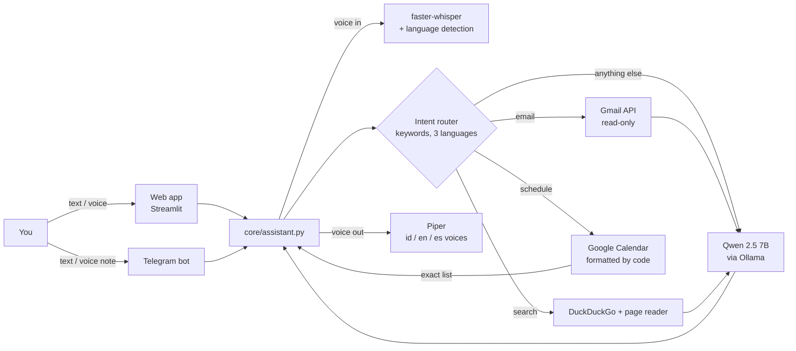

# ⚡ TOKYO

> **T**racks **O**bligations, **K**eeps **Y**ou **O**n-time

A private, self-hosted personal assistant for student life in Madrid. Talk to it or type to it — in Indonesian, English or Spanish — on Telegram or in the browser, and it answers out loud in the language you used.

It knows your class schedule, reads your important emails, tells you what to wear, adds deadlines to your calendar and searches the web. **The AI model, speech recognition and voice all run on your own server.** No Gemini, no OpenAI, no per-message bill, and your inbox never leaves your machine.

---

## Table of contents

1. [Why TOKYO exists](#-why-tokyo-exists)
2. [What it can do](#-what-it-can-do)
3. [How it works](#-how-it-works)
4. [The big lesson: code decides, the model writes](#-the-big-lesson-code-decides-the-model-writes)
5. [Tech stack](#-tech-stack)
6. [Project structure](#-project-structure)
7. [Run it locally (Docker)](#-run-it-locally-docker)
8. [Connect Google (Calendar + Gmail)](#-connect-google-calendar--gmail)
9. [Connect Telegram](#-connect-telegram)
10. [Deploy to a VPS](#-deploy-to-a-vps)
11. [Configuration](#-configuration)
12. [Testing](#-testing)
13. [Troubleshooting](#-troubleshooting)
14. [Security](#-security)
15. [Costs](#-costs)
16. [Known limitations](#-known-limitations)
17. [Roadmap](#-roadmap)

---

## 💡 Why TOKYO exists

Being a Master's student abroad means juggling three things at once: a dense class timetable spread across rooms like MMB-602 and MMB-703, an inbox mixing university deadlines with promotions and security alerts, and a city where the weather decides whether you need a coat or an umbrella. The information is all there, it's just scattered across Google Calendar, Gmail and a weather app, and it's in three languages.

The first version of TOKYO was a Streamlit dashboard powered by Gemini. It worked, but it had three problems that pushed this rebuild:

**1. Privacy.** An assistant that reads your email and calendar is, by definition, handling your most personal data. Sending every email snippet to a cloud API felt wrong for something meant to run every day.

**2. Dependence and limits.** The old code had a list of five fallback Gemini models, because servers were often busy or rate-limited. An assistant that sometimes isn't there isn't an assistant.

**3. Learning.** Building it locally forces you to understand every layer: speech-to-text, language detection, tool calling, OAuth, Docker networking, prompt design. Calling one API teaches you one thing; building TOKYO teaches you the whole stack.

So the goal became: **one assistant, private by design, reachable from my phone, that speaks my languages.**

### Why the name?

Because a good assistant should be like Tokyo's trains: punctual, precise, and you never think about how it works. The acronym says the job: **Tracks Obligations, Keeps You On-time**.

---

## ✨ What it can do

| Ask | What happens | Who answers |
|---|---|---|
| "Besok ada kelas apa?" | Tomorrow's classes with exact times and rooms | Code (instant, exact) |
| "¿Qué tengo el miércoles?" | Wednesday's schedule, headers in Spanish | Code |
| "What should I wear today?" | Outfit advice from the live Madrid forecast | LLM |
| "Cek emailku, ada yang penting?" | Important emails summarized, promotions filtered, phishing warnings | LLM over Gmail data |
| "Search the opening hours of Museo del Prado" | Reads the best web page and answers with its source | LLM over one web page |
| "Tambahkan deadline Essay AI tanggal 2026-10-30" | Creates an all-day event in Google Calendar | LLM tool call |
| 🎙️ A voice note in any of the 3 languages | Transcribed, answered, and spoken back in the same language | Whisper → router → Piper |

**Two doors, one brain:** the same core powers the web app (Streamlit) and the Telegram bot.

**Telegram commands:** `/start`, `/voice` (toggle spoken replies for text messages), `/reset` (clear conversation memory).

---

## 🧠 How it works



Think of it as **one kitchen with two serving windows**. `core/assistant.py` is the kitchen: every recipe (calendar, email, search, voice, language) lives there. The web app and the Telegram bot are just windows where orders come in and plates go out. Improve the kitchen once, and both windows get better.

### The life of one voice message

1. **Hear.** faster-whisper transcribes the audio *and* detects the language from your accent.
2. **Decide the language.** Whisper's guess wins for voice; for text, a stopword vote (`qué`, `tengo` → Spanish) beats statistical detection on short messages.
3. **Route.** Keyword rules in three languages decide the path, in this order: **email → web search → schedule → general chat**. The order matters: "*cari jadwal misa*" (search for mass times) contains "jadwal" (schedule) but is clearly a search.
4. **Fetch.** Calendar, Gmail, Open-Meteo or the web, depending on the route.
5. **Write.** Either code formats the answer directly (schedules), or the LLM writes it from the fetched data, instructed to reply *only* in the detected language.
6. **Speak.** Piper reads the reply with the voice matching that language. On Telegram it's converted to OGG/Opus so it arrives as a real voice note.

---

## 🎯 The big lesson: code decides, the model writes

This is the most interesting part of the project, and it was learned the hard way. A small local model is like a talented new intern: great at writing a friendly sentence, unreliable at precise bookkeeping. Every time we asked the model to *choose* or *combine* things, it got something wrong:

| Task given to the model | What went wrong | Fix: move the decision into code |
|---|---|---|
| Summarize a 7-day schedule | Mixed up times, dropped course names, shifted day labels by one | Code formats schedules directly; the model never touches them |
| Understand "minggu ini" | Indonesian "minggu" means both *week* and *Sunday* | Code parses dates in 3 languages (`core/dates.py`) |
| Translate day headers | Labeled Thursday's events as "Friday" | Headers are pre-written in the reply language |
| Detect Spanish in "¿Qué tengo el miércoles?" | Too short for statistical detection | Stopword vote first, `langdetect` as tie-breaker |
| Notice the calendar was down | Said "you have no classes" (dangerous) | Explicit `CALENDAR NOT CONNECTED` message |
| Pick between summer and winter mass times | Blended both tables | Code drops the off-season table |
| Reconcile two websites that disagree | Stitched pieces of both, cited the wrong one | Code opens 3 pages in parallel, keeps **one** best source |
| Decide when to call a tool | Sometimes wrote `Web_search({...})` as plain text | Code detects that pattern and runs the tool anyway |

The rule that came out of it:

> **If an answer must be exact, code produces it. If it must sound human, the model writes it.**

That is also why schedule answers are instant (≈0.1 s) while chat answers take seconds: the fastest, most accurate LLM call is the one you don't make.

### Why Qwen 2.5 7B?

We started with **Qwen 2.5 3B** (chosen over Llama 3.2 3B because Qwen is trained on 29+ languages including Indonesian, and is more consistent at tool calling). It handled schedules and weather fine once the logic moved into code, but it still misread a simple table of mass times even with a single clean source. **Qwen 2.5 7B** read it correctly. The cost: about 5 GB of RAM and slower answers. Switching back is one line in `.env`.

---

## 🛠 Tech stack

| Layer | Tool | Why |
|---|---|---|
| LLM | [Ollama](https://ollama.com) + `qwen2.5:7b` | Runs on CPU, OpenAI-style API, model swap = one env var |
| Speech-to-text | [faster-whisper](https://github.com/SYSTRAN/faster-whisper) `small`, int8 | Multilingual, detects language, fast on CPU |
| Text-to-speech | [Piper](https://github.com/rhasspy/piper) | Local, fast, has Indonesian, English and Spanish voices |
| Language detection | Stopword vote + `langdetect` | Reliable on short questions |
| Calendar / Email | Google Calendar API, Gmail API (`gmail.readonly`) | Read everything, write only calendar events |
| Weather | [Open-Meteo](https://open-meteo.com) | Free, no API key |
| Web search | `ddgs` (DuckDuckGo) + `trafilatura` | Free, no key; reads the actual page, not just snippets |
| Web UI | Streamlit | Built-in chat and microphone recorder |
| Chat app | python-telegram-bot (long polling) | No domain or open port needed |
| HTTPS | Caddy | Automatic Let's Encrypt certificates |
| Packaging | Docker Compose | Clean laptop, same setup locally and on the server |

---

## 📁 Project structure

```
tokyo-assistant/
├── main.py                 # Web app (Streamlit): chat, mic, weather, agenda, map
├── bot.py                  # Telegram bot: text, voice notes, /voice, /reset
├── google_login.py         # One-time Google OAuth login (runs inside Docker)
├── config.py               # All settings, read from .env
├── core/
│   ├── assistant.py        # The "kitchen": routing, tools, Reply object
│   ├── brain.py            # Ollama client, tool loop, search-query rewriter
│   ├── context.py          # System prompt with live calendar + weather (5-min cache)
│   ├── dates.py            # "besok", "viernes", "this week" → actual dates
│   ├── intents.py          # Email / search keyword detection
│   ├── lang.py             # Language detection + voice per language
│   └── voice.py            # Whisper (ears) + Piper (mouth) + OGG conversion
├── services/
│   ├── calendar_svc.py     # Google login, read all calendars, add events, formatting
│   ├── gmail_svc.py        # Recent inbox mails, important first, promos filtered
│   ├── search_svc.py       # Search, read pages, pick one source, season filter
│   ├── weather_svc.py      # Open-Meteo forecast
│   └── map_svc.py          # OpenStreetMap map for the web sidebar
├── scripts/
│   └── download_voices.sh  # Downloads Piper voices
├── secrets/                # token.json + credentials.json (never committed)
├── Dockerfile
├── docker-compose.yml      # ollama, web, bot, caddy (caddy only with --profile prod)
├── Caddyfile
├── requirements.txt
└── .env.example
```

---

## 🚀 Run it locally (Docker)

Everything runs in containers, so your laptop stays clean: no Python, Ollama or ffmpeg installed on the host.

**Requirements:** Docker Desktop or OrbStack, with **at least 8 GB of memory** assigned (Settings → Resources). The 7B model alone needs about 5 GB.

```bash
git clone https://github.com/VinsensiusF/TOKYO.git tokyo-assistant
cd tokyo-assistant

cp .env.example .env              # then edit it (see Configuration)
mkdir -p secrets                  # Google files go here (next section)

docker compose up -d --build      # first build takes ~5-10 min
docker compose exec ollama ollama pull qwen2.5:7b
```

Open **http://localhost:8501** and log in with your `WEB_PASSWORD`. The microphone works on `localhost` because browsers treat it as a secure origin.

> **Mac note:** inside Docker, Ollama runs on CPU only (no Apple GPU). That's slower than native Ollama, but it's an honest preview of how fast TOKYO will be on a CPU-only VPS.

Clean up completely at any time:

```bash
docker compose down -v      # containers + model + caches
docker image prune -a       # images
```

---

## 🔑 Connect Google (Calendar + Gmail)

**1. Create OAuth credentials (once).**
In [Google Cloud Console](https://console.cloud.google.com): create a project, enable **Google Calendar API** and **Gmail API**, then create an OAuth client of type **Desktop app** and download it as `secrets/credentials.json`.

**2. Publish the app (important).**
Go to **Google Auth Platform → Audience → Publish app**. In *Testing* mode, Google expires your login every 7 days and TOKYO silently goes blind. Personal use doesn't need verification; you'll just click through an "unverified app" warning.

**3. Log in from inside Docker.**
Containers have no browser, so the login server listens on a port that Docker maps to your laptop:

```bash
docker compose run --rm -p 8765:8765 web python google_login.py
```

Open the printed URL, sign in, tick **both** Calendar and Gmail permissions, and wait for `✅ TOKEN SAVED`. Then:

```bash
docker compose restart web bot
```

`secrets/` is mounted into the containers, so no rebuild is needed. If you ever change the permission list (`SCOPES`), delete `secrets/token.json` and log in again.

---

## 💬 Connect Telegram

1. In Telegram, message **@BotFather**, send `/newbot` and copy the token into `.env` as `TELEGRAM_TOKEN`.
2. `docker compose up -d bot`
3. Send "hi" to your bot. It replies with your chat ID, because it refuses strangers.
4. Put that ID in `.env` as `ALLOWED_CHAT_IDS` and run `docker compose up -d bot` again.

The bot uses **long polling**: it asks Telegram for new messages rather than waiting for Telegram to call it, so it needs no domain, no HTTPS and no open port.

> `docker compose restart` does **not** re-read `.env`. Use `docker compose up -d <service>` after editing it.

---

## 🌍 Deploy to a VPS

### Sizing (measured, not guessed)

With the 7B model, TOKYO used about **7.1 GB** of RAM on a laptop test.

| Component | RAM |
|---|---|
| Qwen 2.5 7B | ~5 GB |
| Whisper `small` × 2 (web + bot) | ~1 GB |
| Streamlit, bot, Caddy | ~0.5 GB |
| OS + headroom | ~1 GB |

| | Minimum | Recommended |
|---|---|---|
| RAM | 8 GB + 4 GB swap | **12–16 GB** |
| CPU | 4 vCPU | **8 vCPU** (7B speed scales with cores) |
| Disk | 40 GB | 80 GB |
| Region | Europe (close to Madrid) | |

x86 and ARM both work. Cheapest fit: Oracle Cloud Always Free (4 ARM cores, 24 GB, €0, but capacity is often full). A reliable paid option: a 16 GB ARM VPS from a European provider. On a tight budget, run `qwen2.5:3b` on 8 GB: schedules, email and weather stay accurate because code handles them; only web answers get weaker.

### Steps

```bash
# On the VPS (Docker installed)
git clone https://github.com/VinsensiusF/TOKYO.git tokyo-assistant
cd tokyo-assistant && mkdir -p secrets

# From your laptop: secrets travel directly, never through GitHub
scp .env user@VPS_IP:~/tokyo-assistant/
scp secrets/token.json secrets/credentials.json user@VPS_IP:~/tokyo-assistant/secrets/

# Back on the VPS
nano Caddyfile                      # replace tokyo.yourdomain.com
docker compose --profile prod up -d --build
docker compose exec ollama ollama pull qwen2.5:7b
```

**Domain:** add a DNS `A` record `tokyo` → your VPS IP. Caddy fetches the HTTPS certificate automatically. HTTPS isn't optional for the web app: browsers only allow the microphone on secure pages.

**Swap safety net** (recommended on 8 GB machines):

```bash
sudo fallocate -l 4G /swapfile && sudo chmod 600 /swapfile
sudo mkswap /swapfile && sudo swapon /swapfile
echo '/swapfile none swap sw 0 0' | sudo tee -a /etc/fstab
```

**Updating:** `git pull && docker compose --profile prod up -d --build`

The web app port is bound to `127.0.0.1` only, so the public reaches it exclusively through Caddy and HTTPS.

---

## ⚙️ Configuration

All settings live in `.env` (copy from `.env.example`).

| Variable | Default | Purpose |
|---|---|---|
| `LLM_MODEL` | `qwen2.5:7b` | Ollama model; `qwen2.5:3b` for 4–8 GB machines |
| `WHISPER_MODEL` | `small` | `base` is faster; `medium` hears accents better but needs ~1.5 GB |
| `DEFAULT_LANG` | `id` | Language used until TOKYO hears you (`id`, `en`, `es`) |
| `TELEGRAM_TOKEN` | — | From @BotFather |
| `ALLOWED_CHAT_IDS` | — | Comma-separated chat IDs allowed to use the bot |
| `WEB_PASSWORD` | — | **Required** before exposing the web app |
| `OLLAMA_URL` | `http://localhost:11434` | Overridden to `http://ollama:11434` in Docker |
| `TZ_NAME` | `Europe/Madrid` | Timezone for dates and schedules |

**Add a language:** add it to `LANGS` and `STOPWORDS` in `core/lang.py`, its day names in `services/calendar_svc.py`, and its Piper voice to `scripts/download_voices.sh`.

---

## 🧪 Testing

Test layer by layer, so a failure points to one place:

```bash
# Brain + calendar + language
docker compose exec web python -c "from core import assistant as a; print(a.ask_text('Besok ada kelas apa?', [], 'id'))"

# Voice round trip: Piper speaks, Whisper listens
docker compose exec web python -c "
from core.assistant import Reply, speak; from core.voice import transcribe
print(transcribe(speak(Reply('Hola, soy TOKYO. Hoy hace sol.','es'))))"

# Language detection
docker compose exec web python -c "
from core.lang import detect_text
for t in ['¿Qué tengo el miércoles?', 'What should I wear?', 'besok ada apa', 'ok']:
    print(repr(t), '->', detect_text(t, 'id'))"

# What the model actually sees for a schedule question
docker compose exec web python -c "
from core import context; from core.dates import days_asked
print(context.format_agenda(context.events(), days_asked('besok'), 'id'))"

# Raw web search material
docker compose exec web python -c "from services.search_svc import web_search; print(web_search('Museo del Prado horario'))"
```

---

## 🩺 Troubleshooting

| Symptom | Cause | Fix |
|---|---|---|
| `failed to connect to the docker API` | Docker isn't running | Open Docker Desktop / OrbStack |
| `Connection refused :11434` | Ollama not reachable | `docker compose ps`; check `OLLAMA_URL` |
| `model "qwen2.5:7b" not found` | Model not downloaded | `docker compose exec ollama ollama pull qwen2.5:7b` |
| `Calendar unavailable: ... token.json missing or invalid` | No Google login yet | Run `google_login.py` (see above) |
| `invalid_grant` | Token expired (app still in *Testing*) | Publish the app, delete `token.json`, log in again |
| "Gmail connection failed" | Token lacks the Gmail permission | Delete `token.json`, log in again, tick both boxes |
| `bot-1` restarting in a loop | `TELEGRAM_TOKEN` empty | Fill it in, or `docker compose stop bot` |
| `.env` change ignored | `restart` doesn't reload env | `docker compose up -d web bot` |
| Ollama killed mid-answer | Out of memory | Raise Docker memory, add swap, or use the 3B model |
| "Search failed" | DuckDuckGo rate limit | Wait a few minutes and retry |
| First answer takes ~1 minute | Model loading into RAM / Whisper downloading | Normal, only the first time |
| Microphone blocked on phone | Page isn't HTTPS | Deploy with a domain + Caddy |

Logs: `docker compose logs --tail 50 web` (or `bot`, `ollama`).

---

## 🔒 Security

- **Secrets never touch Git.** `.env`, `secrets/`, `token.json` and `credentials.json` are in `.gitignore`. Keep this repository **private**.
- **Least privilege.** Gmail is `gmail.readonly`: TOKYO can't send, delete or modify email. It can only add events to the calendar.
- **Locked doors.** The web app requires `WEB_PASSWORD`; the Telegram bot only answers `ALLOWED_CHAT_IDS`; Ollama has no public port.
- **Private by design.** Email, calendar, voice and the LLM all run on your own server. The only outside calls are Google's APIs, Open-Meteo, Telegram, and web searches you explicitly ask for.
- **Phishing awareness.** Emails asking you to log in, verify, pay or reset a password get a warning to use the official app instead of the email's links.

---

## 💶 Costs

| Item | Cost |
|---|---|
| LLM, speech, voice | €0 (open models, your own CPU) |
| Google APIs, Open-Meteo, DuckDuckGo, Telegram | €0 |
| VPS | €0 (Oracle Free) to roughly €15–30/month (16 GB) |
| Domain | ~€10–12/year |

No per-message fees: the 1,000th question costs the same as the first.

---

## ⚠️ Known limitations

- **Speed.** On CPU, a 7B model takes roughly 15–40 seconds per LLM answer depending on the machine. Schedule answers are instant because they skip the model.
- **Web answers are only as good as the web.** For the same church, three listing sites published two different mass schedules. TOKYO names its source, so verify important facts there.
- **Seasonal schedules** are filtered by month (July–August = summer, October–May = winter); June and September keep both tables.
- **"Next week"** isn't supported yet; schedules cover the next 7 days.
- **Whisper `small`** occasionally mishears words ("Misa" → "Bisa"); `medium` is more accurate but heavier.
- **Google Tasks / Reminders** (e.g. assignments shown with a checkbox) aren't read, only Calendar events.

---

## 🗺 Roadmap

- [ ] Morning briefing at 07:00 on Telegram: today's classes, weather, outfit, important emails
- [ ] Alarm 2 hours before the first class (phone automation reading the calendar)
- [ ] Streaming replies, so text appears while the model is still writing
- [ ] Google Tasks support for assignments
- [ ] "Next week" and date-range questions
- [ ] Self-hosted SearXNG as a rate-limit-free search backend
- [ ] Separate `SEARCH_MODEL`, so chat can use a faster model

---

<p align="center"><i>Built in Madrid, one bug at a time. ⚡</i></p>